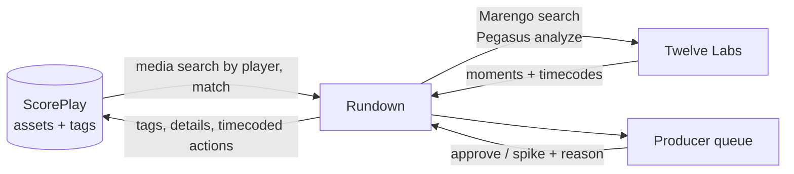

# Rundown (Name WIP)

Rundown takes every asset from one game and drafts the content a club should make from it. A producer gets a short list of proposed pieces, each aimed at an audience, and approves or spikes them. Rundown also lists what it considered and dropped, with a reason, so a person can rescue the clip the model got wrong.

Built in two days at the Spurs² Hackathon (UT Austin, October 22 to 23, 2026) for Problem 1 of the [builder brief](https://scoreplay.notion.site/Spurs-Hackathon-Builder-Brief-3fb9d8f0d4ce815096d4dc8294142346), Assisted Auto-Production. It runs on the [ScorePlay](https://developer.scoreplay.io/) and [Twelve Labs](https://docs.twelvelabs.io/) APIs with match content from Tottenham Hotspur and the San Antonio Spurs.

Status: the studio works end to end on Tottenham's full match against Manchester United. Open `/studio` to see it, or press **Present the demo** there for the seven-step walkthrough in [docs/demo-script.md](docs/demo-script.md). The live view is at `/studio/130852725/live`. It runs on Fly.io behind a site password ([docs/deploy.md](docs/deploy.md)).

## What one run produced

`scripts/studio/analyze.ts` read the 1 hour 45 minute match in 14 stages, in 13 minutes 34 seconds. The result is committed as `src/lib/studio/data/mnu-tot.json`, so the studio opens without waiting on any API.

- 76 moments, from the crowd's noise, the commentary and Twelve Labs. Twelve Labs saw 48 of them on camera.
- 93 candidates weighed and dropped, each with a reason a producer can argue with.
- 18 clips planned for four audiences: match fans, season ticket holders, a sponsor and international fans. 16 are rendered and uploaded into ScorePlay next to the match.
- 30 timecoded logs and 8 tags written onto the match in ScorePlay, read back to confirm they landed.
- 9 of its top 10 moments overlap clips Tottenham's editors made by hand. Same-length picks at random average 1.7, and picking the loudest crowd moments gets 2.5. Counting only single-moment club clips with at least 3 seconds of overlap, it is 4 of 10.

## Where ScorePlay and Twelve Labs come in

| Platform | What Rundown uses it for | Code |
| --- | --- | --- |
| ScorePlay | Reads the match and the club's own clips made from it | `src/lib/studio/library.ts` |
| ScorePlay | Uploads each rendered clip into the match's collection | `scripts/studio/upload.ts` |
| ScorePlay | Writes every top moment back as a timecoded log on the match | `scripts/studio/writeback.ts` |
| ScorePlay | Records a producer's approve or reject as a tag on the clip | `src/lib/studio/review.ts` |
| Twelve Labs | Marengo confirms moments on camera and finds them in plain words | `scripts/studio/visual.ts`, `src/lib/studio/search.ts` |
| Twelve Labs | Pegasus describes each moment for the clip plan | `scripts/studio/descriptions.ts` |
| Twelve Labs | MatchWatch segmentation and editorial review | `scripts/studio/matchwatch.ts` |

The team's Twelve Labs allowance ran out on the morning of 23 October. Since then, search in the studio answers from results recorded before that (`src/lib/studio/search-recorded.ts`), and the page says so.

The `/api/rundown` engine in `src/lib/rundown` is an earlier, separate pipeline for any match on the platform. [docs/engine.md](docs/engine.md) describes it.

## Studio

Built with [MatchWatch](https://github.com/Jazzbai/matchwatch/tree/hacketong). The studio ports the soccer event prompts from `HtownKickoff-main/src/components/stream/HighlightStudio.tsx` and the Jev review prompt, schema, and 50/30/20 score renormalization from `HtownKickoff-main/src/lib/jev.ts`. `HtownKickoff-main/src/lib/highlight-plan.ts` and `HtownKickoff-main/HIGHLIGHTS.md` explain their selection workflow. Rundown keeps its ranking unchanged and stores Jev estimates alongside its scores.

## What the producer gets

A producer on match day has hundreds of assets and time to cut maybe five of them. The brief puts it as "the right five options in front of a producer in the time it used to take to find one." Rundown aims at that:

- **Proposals.** Each one names the moment, the source asset and timecode, the audience (season ticket holder, sponsor, first-time viewer abroad), the format and length, and why it should exist now.
- **Spiked list.** Everything Rundown looked at and passed on, with the reason. A producer's first question is what the system skipped.
- **Approve or spike.** Nothing publishes without a person. Approved pieces get written back to ScorePlay as tags and timecoded actions on the source asset.

Proposals can start from three signals: the footage itself (the bench reacting, the away end, the moment the stadium goes quiet), fan reaction on social, or the archive.

## How it works



ScorePlay is the system of record. If a decision is not written onto the asset there, the club does not know it happened. Every Twelve Labs asset carries its ScorePlay asset ID in its custom ID field, which is how results find their way back.

## Run it

You need [bun](https://bun.sh) 1.3 and Node 22 or later. Next.js still runs on Node; bun installs packages and runs scripts.

```sh
bun install
cp .env.example .env.local   # then fill in your team's keys
bun dev
```

Open http://localhost:3000. The landing page is `/` and the studio is `/studio`. Without keys the studio still opens from the committed run: the sections that need ScorePlay say it did not answer, and search says there is no Twelve Labs key. `bun scripts/studio/validate.ts` checks the committed run file.

| Variable | Where it comes from |
| --- | --- |
| `SCOREPLAY_API_KEY` | Created by your team on its ScorePlay platform |
| `SCOREPLAY_API_URL` | `https://media.scoreplay.io/v1` |
| `TWELVELABS_API_KEY` | Your team's Twelve Labs org. Give it an expiry of a few months, not never. |
| `TWELVELABS_INDEX_ID` | The pre-built base index shared at onboarding |

To put the app online, follow [docs/deploy.md](docs/deploy.md).

## Content rules

The match footage, photos and logos belong to the clubs and leagues. For this event:

- The organizers expect teams to process the media. Rundown may download, clip, transform and render it, locally or in the cloud, but it does not keep it. Working copies are deleted when the job finishes, nothing is committed or re-hosted, and derived clips go back into ScorePlay.
- Nothing posts outside the event. Social publishing is demo only.
- Platforms are wiped after the event.
- Only registered teammates use the team's credentials.

## Working in this repo

Branch, open a PR, squash-merge once CI passes. [CONTRIBUTING.md](CONTRIBUTING.md) covers the one-time Coordigent setup and lists the checks. [AGENTS.md](AGENTS.md) holds the conventions and says which skill in `.claude/skills` to use for each task.
