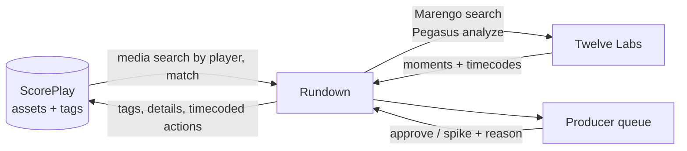

# Rundown

Rundown takes every asset from one game and drafts the content a club should make from it. A producer gets a short list of proposed pieces, each aimed at an audience, and approves or spikes them. Rundown also lists what it considered and dropped, with a reason, so a person can rescue the clip the model got wrong.

It was built in two days at the Spurs² Hackathon (UT Austin, October 22 to 23, 2026) for Problem 1 of the [builder brief](https://scoreplay.notion.site/Spurs-Hackathon-Builder-Brief-3fb9d8f0d4ce815096d4dc8294142346), Assisted Auto-Production, on the [ScorePlay](https://developer.scoreplay.io/) and [Twelve Labs](https://docs.twelvelabs.io/) APIs, with Tottenham Hotspur's full match against Manchester United.

## Team and this repo

Team 7 built Rundown: Feria, Hamid, Sam, Ayan and Bryan. Feria and Hamid built the MatchWatch prompts the studio uses. The team's repository, with each person's commits, is `SamGu-NRX/spurs-hackathon`.

This repo imports that code as one commit and carries it on. Every commit after the import is Ayan's:

| Commit | What it does |
| --- | --- |
| `docs(readme)` describe the studio as built | The first honest README for the shipped studio |
| `fix(studio)` show the confirmed writeback | The run's last stage reports the 30 logs ScorePlay confirmed, not "Rehearsal" |
| `feat(studio)` storage call | Step 4 shows the stretches of the match nothing pointed at, as a cold-storage proposal |
| `feat(studio)` log a rescued candidate | "Make a clip anyway" writes a timecoded `rundown-rescued` log onto the match |
| `fix(studio)` answer typed searches from the run's moments | Search falls back to the run's 76 moments, and "shot on target" stops matching "off target" |
| `chore(agents)` one person's project | Retires the five-agent coordination, the PR bots and their workflows |
| `fix(studio)` search without a Twelve Labs key | Search works on a fresh clone, from recorded results and then the run's moments |
| `feat(studio)` edit decision lists | Every planned clip downloads as a CMX 3600 EDL for Premiere, Resolve or Avid |
| `fix(studio)` decisions without ScorePlay | Approve, Reject and rescues work offline, held on the page and labelled as not written |
| `fix(studio)` say why the footage is dark | The page says ScorePlay is not connected and explains the missing video |

## What works now

The event's ScorePlay platform was wiped afterwards and the team's Twelve Labs allowance is spent, so the studio runs from the committed analysis. Nothing on the page claims a write that did not happen.

Works with no keys:

- The run's 14 stages, the 76 moments with their evidence, and the timeline.
- The 93 dropped candidates with their reasons, and the storage panel.
- The 18 planned clips, the club check, and an EDL download for every clip and the recap.
- Search, from the recorded Twelve Labs results and then the run's own moments.
- Approve, Reject and "Make a clip anyway", held on the page until reload.

Needs the platforms: video playback, the club's own videos and the uploads in the library, writing tags and logs to ScorePlay, live Twelve Labs search, and the live view at `/studio/130852725/live`.

## What one run produced

`scripts/studio/analyze.ts` read the 1 hour 45 minute match in 14 stages, in 13 minutes 34 seconds. The result is committed as `src/lib/studio/data/mnu-tot.json`, so the studio opens without waiting on any API.

- 76 moments, from the crowd's noise, the commentary and Twelve Labs. Twelve Labs saw 48 of them on camera.
- 93 candidates weighed and dropped, each with a reason a producer can argue with.
- 18 clips planned for four audiences: match fans, season ticket holders, a sponsor and international fans. 16 are rendered and uploaded into ScorePlay next to the match.
- 30 timecoded logs and 8 tags written onto the match in ScorePlay, read back to confirm they landed.
- 9 of its top 10 moments overlap clips Tottenham's editors made by hand. Same-length picks at random average 1.7, and picking the loudest crowd moments gets 2.5. Counting only single-moment club clips with at least 3 seconds of overlap, it is 4 of 10.

## Where ScorePlay and Twelve Labs come in

| Platform | What Rundown uses it for | Code |
| --- | --- | --- |
| ScorePlay | Reads the match and the club's own clips made from it | `src/lib/studio/library.ts` |
| ScorePlay | Uploads each rendered clip into the match's collection | `scripts/studio/upload.ts` |
| ScorePlay | Writes every top moment back as a timecoded log on the match | `scripts/studio/writeback.ts` |
| ScorePlay | Records a producer's approve or reject as a tag on the clip | `src/lib/studio/review.ts` |
| Twelve Labs | Marengo confirms moments on camera and finds them in plain words | `scripts/studio/visual.ts`, `src/lib/studio/search.ts` |
| Twelve Labs | Pegasus describes each moment for the clip plan | `scripts/studio/descriptions.ts` |
| Twelve Labs | MatchWatch segmentation and editorial review | `scripts/studio/matchwatch.ts` |

The `/api/rundown` engine in `src/lib/rundown` is an earlier, separate pipeline for any match on the platform. [docs/engine.md](docs/engine.md) describes it.

## What the producer gets

A producer on match day has hundreds of assets and time to cut maybe five of them. The brief puts it as "the right five options in front of a producer in the time it used to take to find one." Rundown aims at that:

- **Proposals.** Each one names the moment, the source asset and timecode, the audience (season ticket holder, sponsor, first-time viewer abroad), the format and length, and why it should exist now.
- **Spiked list.** Everything Rundown looked at and passed on, with the reason. A producer's first question is what the system skipped.
- **Approve or spike.** Nothing publishes without a person. Approved pieces get written back to ScorePlay as tags and timecoded actions on the source asset.

Proposals can start from three signals: the footage itself (the bench reacting, the away end, the moment the stadium goes quiet), fan reaction on social, or the archive.

## How it works



ScorePlay is the system of record. If a decision is not written onto the asset there, the club does not know it happened. Every Twelve Labs asset carries its ScorePlay asset ID in its custom ID field, which is how results find their way back.

## MatchWatch

Built with [MatchWatch](https://github.com/Jazzbai/matchwatch/tree/hacketong). The studio ports the soccer event prompts from `HtownKickoff-main/src/components/stream/HighlightStudio.tsx` and the Jev review prompt, schema, and 50/30/20 score renormalization from `HtownKickoff-main/src/lib/jev.ts`. `HtownKickoff-main/src/lib/highlight-plan.ts` and `HtownKickoff-main/HIGHLIGHTS.md` explain their selection workflow. Rundown keeps its ranking unchanged and stores Jev estimates alongside its scores.

## Run it

You need [bun](https://bun.sh) 1.3 and Node 22 or later. No keys are needed.

```sh
bun install
bun dev
```

Open http://localhost:3000/studio. Press **Present the demo** for the seven-step walkthrough the team gave the judges ([docs/demo-script.md](docs/demo-script.md)). `bun scripts/studio/validate.ts` checks the committed run file.

Keys are optional and only help against a ScorePlay platform and Twelve Labs index someone still has. Copy `.env.example` to `.env.local` to set them.

| Variable | Where it comes from |
| --- | --- |
| `SCOREPLAY_API_KEY` | Created by your team on its ScorePlay platform |
| `SCOREPLAY_API_URL` | `https://media.scoreplay.io/v1` |
| `TWELVELABS_API_KEY` | Your team's Twelve Labs org. Give it an expiry of a few months, not never. |
| `TWELVELABS_INDEX_ID` | The pre-built base index shared at onboarding |

[docs/deploy.md](docs/deploy.md) covers running it on Fly.io.

## Content rules

The match footage, photos and logos belong to the clubs and leagues. At the event, teams could process the media but not keep, post or re-host it, and the platforms were wiped afterwards. This repo holds no media, only IDs, timecodes, text and metadata. The EDLs are timecodes and the master's file name, which an editor relinks to their own copy.

## Working in this repo

Run `bun run lint && bun run typecheck && bun run test && bun run build`, then push to `main` once all four pass. CI runs the same checks with no API keys. [AGENTS.md](AGENTS.md) holds the conventions for anyone, or any agent, working here.
